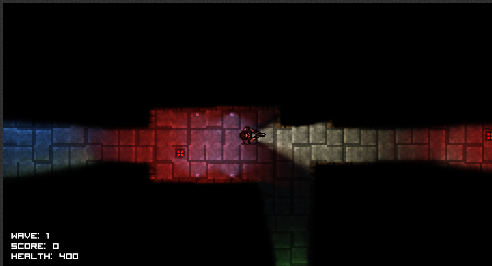

# Zombie Shootdown

**[▶ Play in your browser](https://techmatt101.github.io/ZombieShootdown/)**

A 2D top-down horror survival shooter. You're alone in an endless maze of dark rooms and corridors with a flickering torch, a gun, and a bigger zombie horde every wave. Survive as long as you can.



> [!IMPORTANT]
> The game renders with **WebGPU**, so it needs a recent desktop version of **Google Chrome** (or another Chromium browser with WebGPU enabled).

## How to play

Shoot, dodge and run. Each wave sends a bigger horde, spawned just out of sight. Zombies give points when they die, and clearing a wave gives a bonus. Get bitten too often and it's game over.

The dark matters. You only see what your torch and the room lights reach. Zombies hidden from view are invisible, apart from their glowing red eyes. Places you've already been stay faintly on the map. You can shoot out lamps and wall lights, and you can push lamps around.

### Controls

| Action                | Keyboard / mouse         | Gamepad           |
|-----------------------|--------------------------|-------------------|
| Move                  | `W` `A` `S` `D` / arrows | Left stick        |
| Aim                   | Mouse                    | Right stick       |
| Shoot                 | Left click / `Space`     | Right trigger     |
| Open doors            | `E` / right click        | `A`               |
| Zoom                  | `+` / `-`                |                   |
| Menu                  | `Esc`                    |                   |
| Toggle debug view     | `` ` `` (backtick)       | Back / View       |

### Modes

- **Arcade**: wave-based survival with score.
- **Dev Level**: an endless sandbox with zombies wandering around. Good for exploring the world and lighting.

## Features

- **Endless procedural world**: rooms, corridors and doors are generated in 16×16 tile chunks from a seed. A web worker streams them in around you and unloads them far away, and they come back identical when you return.
- **Dynamic 2D lighting**: a cone-shaped torch, coloured lamps and wall lights, muzzle flashes, line-of-sight visibility polygons, soft shadows cast by bodies, normal-mapped sprites and a tone-mapped high-contrast composite.
- **Fog of war**: map memory reveals what you've seen and keeps it dimly drawn.
- **Hand-written WebGPU renderer**: instanced sprite batching, float light buffers, stencil shadow volumes, distance-scaled blur. No game engine and no runtime dependencies.

## Development

Requires Node 22.12+ and [pnpm](https://pnpm.io).

```sh
pnpm install
pnpm dev          # dev server with hot reload
pnpm build        # typecheck + production build to dist/
pnpm preview      # serve the production build
pnpm test         # vitest unit tests
pnpm lint         # oxlint
pnpm check        # typecheck + lint + tests (run before committing)
```

Dev URL options:

- `?dev` boots straight into the Dev Level.
- `?seed=<n>` fixes the world seed.

In dev builds the debug view starts on. It shows a perf overlay (fps, frame timings, chunks, entities, draw calls), collision boxes and light rays, and exposes `window.game` / `window.debug`. Game settings and key bindings live in `src/config.ts`.

### Project layout

| Path               | What's there                                                                  |
|--------------------|-------------------------------------------------------------------------------|
| `src/world/`       | Chunk generation, streaming worker, tile map, raycasting                      |
| `src/core/`        | Entity/component engine: components, systems, factories, behaviours           |
| `src/core/render/` | WebGPU renderer, sprite batch, shaders (`gpu/shaders/*.wgsl`)                  |
| `src/lighting/`    | Visibility polygons, light field caching, map memory                          |
| `src/client/`      | Game modes, HUD, menus, perf overlay                                          |
| `src/testing/`     | Shared test fixtures (ASCII tile worlds, fake GPU, recording canvas)          |
| `public/assets/`   | Images (with `_n` normal maps and `_e` emissive maps), audio, fonts           |

[`CLAUDE.md`](CLAUDE.md) covers the architecture and the performance and code-style rules in depth.

### Deployment

Every push to `master` runs `pnpm check`, builds the game and deploys it to GitHub Pages. See [`.github/workflows/deploy.yml`](.github/workflows/deploy.yml).

Built with [TypeScript](https://www.typescriptlang.org), [Vite](https://vite.dev), [Vitest](https://vitest.dev) and [oxlint](https://oxc.rs).
